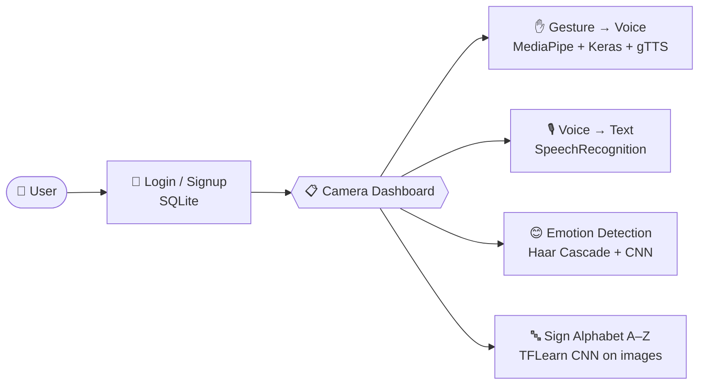

<div align="center">

# 🤟 Sign Language Recognition

### *Giving hands a voice, and voices a face.*

A multimodal accessibility toolkit that turns **hand signs into letters**, **gestures into spoken phrases**, **speech into text**, and **facial expressions into emotions**, all behind one Flask web dashboard.


</div>

---

## 💡 Why this project?

Millions of people communicate through sign language, but most of the people around them don't understand it. This project tries to close that gap from **both directions**:

| Person | Communicates by | This project turns it into |
|---|---|---|
| 🧏 Signer | Hand signs (A–Z) | Recognised letters |
| 🧏 Signer | Hand gestures | **Spoken voice** phrases |
| 🗣️ Speaker | Voice | On-screen **text** |
| 🙂 Anyone | Facial expression | Detected **emotion** and a stress signal |

---

## ✨ Four modules, one dashboard



### 1. ✋ Gesture → Voice (`gesture_to_voice.py`)
Live webcam feed. **MediaPipe** finds 21 hand landmarks, a pre-trained Keras model (`mp_hand_gesture/`) classifies the gesture, and **gTTS** speaks the matching phrase out loud.

| Gesture | 🔊 Spoken phrase |
|---|---|
| ☝️ `one` | "one" |
| ✌️ `two` | "two" |
| 🤟 `three` | "three" |
| 🖐️ `four` | "four" |
| 👌 `super` | "i am fine" |
| 👍 `up` | "go up" |
| 👎 `down` | "go down" |
| 🤙 `call` | "Call me" |
| 😁 `smile` | "smile please" |
| ✊ `zero` | "stop" |

### 2. 🎙️ Voice → Text (`voice_to_text.py`)
Listens to the microphone, filters out ambient noise, and transcribes speech with Google Speech Recognition. A hearing-impaired user can then read what was said.

### 3. 😊 Emotion & Stress Detection (`TestEmotionDetector.py`)
Detects faces with an OpenCV **Haar cascade**, then classifies each one into **7 emotions** with a CNN trained on 48×48 grayscale faces:
`Angry · Disgusted · Fearful · Happy · Neutral · Sad · Surprised`.
Negative emotions are flagged as **"Stress detected"**.

### 4. 🔤 Indian Sign Language Alphabet (`/cnn` route)
Pick a test image in the web UI, and a **5-layer CNN** (TFLearn) predicts which letter **A–Z** the hand is showing. The image and the result appear side by side.

---

## 🧠 Under the hood: the alphabet CNN

```
Input 50×50×3
  │
  ├─ Conv 32 (3×3, ReLU) → MaxPool 3
  ├─ Conv 64 (3×3, ReLU) → MaxPool 3
  ├─ Conv 128 (3×3, ReLU) → MaxPool 3
  ├─ Conv 32 (3×3, ReLU) → MaxPool 3
  ├─ Conv 64 (3×3, ReLU) → MaxPool 3
  │
  ├─ Dense 1024 (ReLU) → Dropout 0.8
  └─ Dense 26 (Softmax)  →  a … z
```

| Setting | Value |
|---|---|
| Optimizer | Adam, learning rate `1e-3` |
| Loss | Categorical cross-entropy |
| Epochs | 100 |
| Training images | **5,241** (`indian/train`, ~200 per letter) |
| Test images | **312** (`indian/test`) |
| Saved model | `indian/gesturerecognition-0.001-2conv-basic.model.*` |

The **emotion CNN** (`TrainEmotionDetector.py`) is a Keras `Sequential` model: 4 conv layers (32 → 64 → 128 → 128 filters) with dropout, Dense 1024, and a 7-way softmax. It was trained for 50 epochs on 48×48 grayscale faces (FER-2013-style folder layout, 28,709 train / 7,178 validation).

---

## 📁 Project structure

```
sign_language_recognition/
├── app.py                    # Flask app: auth, dashboard, launches each module
├── gesture_to_voice.py       # ✋ MediaPipe gesture → speech
├── voice_to_text.py          # 🎙️ microphone → text
├── TestEmotionDetector.py    # 😊 live emotion detection
├── TrainEmotionDetector.py   # trains the emotion CNN
├── gesture.names             # 10 gesture class labels
├── mp_hand_gesture/          # pre-trained Keras gesture model (SavedModel)
├── model/                    # emotion_model.json + emotion_model.h5
├── haarcascades/             # OpenCV frontal-face cascade
├── indian/
│   ├── train/  test/         # ISL alphabet images (a (1).jpg …)
│   ├── train_model.py        # trains the A–Z CNN
│   └── gesturerecognition-*  # saved TFLearn model
├── templates/                # login, signup, dashboard, CNN pages
└── static/                   # CSS, JS, images
```

---

## 🚀 Getting started

### Prerequisites
- Python 3 with `pip`
- A **webcam** (gesture and emotion modules)
- A **microphone** and an internet connection (speech recognition and gTTS use Google services)

### Install

```bash
git clone https://github.com/Riyuzaki9876/sign_language_recognition.git
```

```bash
cd sign_language_recognition
```

```bash
pip install flask opencv-python numpy tensorflow keras tflearn mediapipe gtts mutagen pygame SpeechRecognition pyttsx3 pyaudio tqdm matplotlib pillow
```

> ⚠️ **TFLearn** is no longer maintained and may not work with the newest TensorFlow. If the `/cnn` page fails to import, try a virtual environment with an older TensorFlow 2.x release.

### Run

```bash
python app.py
```

Open **http://127.0.0.1:5000**, create an account on the signup page, log in, and pick a module from the **Camera Section**.
In webcam windows, press **`q`** to quit.

### Retrain the models (optional)

```bash
cd indian
```

```bash
python train_model.py
```

To retrain the emotion model, put a FER-2013-style dataset in `data/train` and `data/test`, then run `python TrainEmotionDetector.py`.

---

## 🛣️ Roadmap & known limitations

- [ ] Use parameterised SQL queries and hashed passwords in `app.py`. Login and signup currently build queries from raw input, so they are open to SQL injection, and passwords are stored as plain text.
- [ ] Fix the stress check in `TestEmotionDetector.py`. It refers to an undefined `predicted` variable, and its `or` conditions are always true.
- [ ] Stream webcam frames inside the browser instead of opening separate OpenCV windows.
- [ ] Recognise continuous signing (words and sentences), not just single letters.
- [ ] Add a `requirements.txt` with pinned versions.

---

## 🙌 Built with

[Flask](https://flask.palletsprojects.com/) · [TensorFlow / Keras](https://www.tensorflow.org/) · [TFLearn](http://tflearn.org/) · [OpenCV](https://opencv.org/) · [MediaPipe](https://developers.google.com/mediapipe) · [gTTS](https://pypi.org/project/gTTS/) · [SpeechRecognition](https://pypi.org/project/SpeechRecognition/)

<div align="center">

**Made with ❤️ by [Riyuzaki9876](https://github.com/Riyuzaki9876)**

*If this project helped you, consider giving it a ⭐*

</div>
